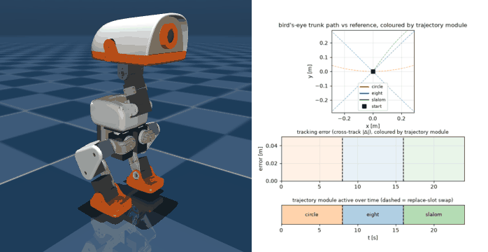
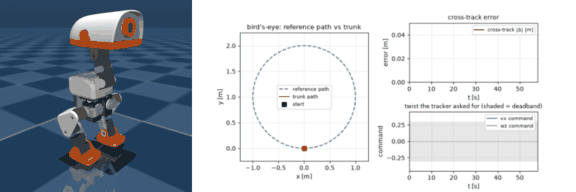

# shinro-demo-microduck

**A walking policy compiled to a 790 KiB `.so` — and a robot whose trajectory you
can swap mid-stride.**

Microduck is a 14-servo, ~25 cm biped whose PPO walking policy is exported to ONNX
and compiled to a **standalone shared object** by the [shinro control
framework](https://github.com/Shinro-xyz/shinro-python-modules). That kernel drives
MuJoCo two ways: called directly through its C ABI, or loaded as a **module on the
Cake supervisory plane**, where the walking policy and the trajectory are separate
modules and the trajectory is replaced live — no restart, no missed tick.



_Circle → eight → slalom, swapped live on the Cake plane. The trajectory is a
separate Cake module; `replace-slot` hands the walking policy a new one while the
resident keeps running and the 50 Hz loop never drops a tick — the panel colours
the path by the module driving it. `make cake` · [details](docs/cake-control-plane.md)._

## Highlights

- **Compiled, not wrapped.** The observation encoder, the network and the action
  post-processing are lowered to a shinro dataflow graph and cross-compiled with
  Zig. The control path links **no onnxruntime, no numpy, no framework** — just a
  790 KiB `.so` and one function.
- **Bit-exact, three ways.** A build-time oracle gate (`3.3e-16`), a per-tick
  lockstep comparison against shinro's interpreter (`≤ 8.9e-16`), and both against
  onnxruntime (`9.1e-07`) — and the same artifact run from **C, C++, Zig, Rust and
  Python is bit-identical**.
- **Tiny and fast, measured on the target.** The deployment host is
  **0.8 MB installed, +1.2 MB RSS, 7.9 ms** to first inference — versus
  onnxruntime's 132.8 MB, 44.8 MB, 121 ms — and the same `.so` runs **750 µs/tick
  on a Raspberry Pi 3 B+** with a flat memory curve over 100,000 ticks.
- **A robot that can change parts of itself while walking.** On the Cake plane the
  policy is a supervised module and the trajectory is a second module; the demo
  asserts `replace-slot` returns **`COMPLETED`**, the **session identity is
  unchanged**, and the walk never misses a tick.

Everything robot-specific the framework deliberately does not ship lives here: the
vendored MJCF + meshes, the policy ONNX, the BAM actuator mirror, the configs and
scenarios, the demos and the integration tests.

## Two ways to run the same policy

| aspect | bare `.so` (`make live`, `make demo`) | Cake plane (`make cake`) |
| --- | --- | --- |
| who loads it | this repo's `MicroduckPolicy` (ctypes) | a Cake resident admits a capsule |
| artifact | `lib/lib_neural_network.so` | a Cake capsule (`CAP_ELF` + descriptor) + the resident |
| symbol | `shinro_step` | `cake_module_entry_v1` |
| the trajectory | host-side Python (`tracker.py`) | **a second, swappable Cake module** |
| the loop | the host's 50 Hz loop | the module's own thread, registered with the resident |
| change a part live | restart the process | `replace-slot`, no restart |

Both drive **the same compiled graph** from the same ONNX, so both produce the same
walk. Cake adds the supervisor around the module; it does not change the control law.

## What this demo is

Microduck is a small biped whose walking policy **is the artifact**. Nothing is
re-implemented and nothing is wrapped: the policy graph is lowered and compiled, and
the 50 Hz loop calls that `.so`. Correctness is **three independent implementations
agreeing**, not one self-consistent run: the build-time oracle gate, the per-tick
interpreter comparison, and both against onnxruntime. There is no hand-converted
checkpoint anywhere — the observation normalizer is baked into the ONNX by the
training exporter, the only path that transfers.

The deployment host is the code that ships, and it is measured: `MicroduckPolicy` is
ctypes plus the standard library, buffers allocated once at load, dimensions read
from the artifact manifest. The no-dependency claim is *asserted by a test in a fresh
interpreter*, and demonstrated from the other side by [`interop/`](interop/README.md)
— four of its five hosts have no Python at all.

The constraints on deploying it were measured on this checkpoint, not assumed, and
each one changed what the runtime does: a **~0.25 m/s deadband** (a slow command
produces a *stand*, not a crawl), a **yaw response that is non-monotonic in the
command** (no open-loop heading profile survives it, so tracking must close the
loop), **no turn-in-place**, and a **home pose that is not self-stabilizing** (the
policy does the balancing — "fixing" it by stiffening the hold would be wrong).

> **Scope, stated once:** this is a rehearsal, not a sim2real claim. It matches the
> training actuator, timing and frame conventions exactly. See
> [fidelity.md](docs/fidelity.md).

## The compile: ONNX → a standalone `.so`

The graph is not re-implemented and not wrapped: it is lowered.

```bash
make compile        # = shinro build scenarios/microduck_walking.toml --out build/compiled_policy
```

`make compile` traces the policy, composes the graph, lowers it to Zig VM data, runs
`zig build`, then **oracle-checks the resulting `.so` against shinro's interpreter**
before stamping and verifying the artifact. Nothing is trusted until that gate
passes:

| stage | artifact | check | measured |
| ----- | -------- | ----- | -------- |
| import | ONNX → 26-node graph | imported graph vs **onnxruntime** (spec reference) | `9.1e-07` (f32 vs f64) |
| compile | `lib/lib_neural_network.so` · 790 KiB | `shinro build` oracle gate: `.so` vs interpreter | `3.3e-16` |
| replay | 50 Hz MuJoCo loop driven from the `.so` | **lockstep parity** per tick | `≤ 8.9e-16` |
| deploy | `.so` through `MicroduckPolicy` | install size, RSS, time to first inference | `0.8 MB`, `+1.2 MB`, `7.9 ms` |
| embed | the same `.so` from C, C++, Zig, Rust, Python | five independent hosts agree | **bit-identical** |
| track | preset reference path, closed loop | cross-track error / path coverage | `8.6 mm` mean / `100%` on a 1 m circle |

The artifact is a plain shared object with one function:

```c
void shinro_step(const double* in, double* out, double* state);   // 61 → 14, state-free
```

Cross-compile to the Pi with `make compile TARGET=aarch64-linux-gnu` (a cross build
can't `dlopen` on the host, so the record marks the oracle `not_run`; link it to a
native run with `--native-record`).

## Run it bare: the compiled `.so`

The simplest host: `MicroduckPolicy` `dlopen`s the `.so` and calls `shinro_step` once
per 50 Hz tick, with the sim beside it.

```bash
make live                          # real-time viewer; keys 0-4 switch the command
make demo                          # per-command GIFs (3-D view + path + velocity)
make gif                           # the walking showcase GIF
make trajectory T=circle           # follow a preset reference path (closed loop)
make interop                       # the same .so from C, C++, Zig, Rust, Python
make footprint                     # deployment host vs shinro adapter vs onnxruntime
```



_The compiled `.so` following the circle reference path closed-loop — a full lap,
driven only by the kernel's 14-D action and the host-side tracker that feeds it the
command block._

The reference-path layers (`MicroduckLoop`, `PurePursuitTracker`) are registered
shinro components built through shinro's own factories — but they run **beside** the
kernel in Python, and it is the host, not Cake, that owns the loop and the
trajectory. That is exactly the seam the Cake demo moves.

## Run it on Cake: the control plane

The same policy, running as a **Cake module** on the Cake supervisory kernel. The
resident admits the capsule, the module owns its thread, and this repo's MuJoCo
client is the plant on the far side of a Unix socket. The trajectory becomes a
**second Cake module**, so it can be replaced live:

```bash
make fetch-cake                    # download + verify the precompiled release for this machine
make cake                          # circle -> eight -> slalom live, rendered (default)
make cake SECS=9                   # shorter
make cake SWAP=circle,eight        # a two-trajectory swap
make cake GIF=                     # skip the render (GIF=cake|full|compact|trajectory)
```

What a run does:

1. `cake-pack deploy` writes a **Plan**: the policy slot, the first trajectory
   module, and a `spare_<t>` slot for every replacement capsule (the resident admits
   capsules at start), with an explicit `--bind microduck:0=trajectory`.
2. The resident activates the graph — the policy owns a thread, the trajectory owns a
   thread — and the sim connects over the socket.
3. The walk runs lockstep: sim → policy reads the command under an **epoch guard** →
   VM → 14 actions; the trajectory reads the pose → pure pursuit → publishes the
   command.
4. Every `SECS/3` seconds the runner sends `admin-probe … replace-slot` with the
   48-byte payload (slot uuid + replacement capsule content id).
5. It asserts the transaction phase is **`COMPLETED`**, the **session identity is
   unchanged**, the slot uuid is unchanged, and the drain retires every module — then
   renders and PASSes.

`make cake` writes two artifacts to `docs/media/cake/`:

- `microduck_cake_walk.gif` — the 3-D walk beside a bird's-eye panel that **colours
  the path by the trajectory module driving it**, marks each swap, and shows the
  module active over time;
- `microduck_cake_swap.png` — how Cake ran each swap: the policy band running
  throughout, the trajectory generations advancing, and the update transaction's
  phases (closure computed → drain the retiring generation → apply the
  `live_snapshot` rebind → publish the binding snapshot → reclaim the retired
  generation).

No Cake code enters this repository and no MuJoCo enters the Cake side: the wire is
two little-endian f64 arrays (the graph's own port layout, plus the pose the
trajectory needs). The resident and the capsules are a **precompiled release** built
in the private [`shinro-bench/cake`](../shinro-bench/cake) tree and published per
target (`x86_64` and `aarch64`); this repository only fetches and runs it. There is
no `cake_*` header, no entry symbol and no lifecycle callback here — see
[The Cake control plane](docs/cake-control-plane.md).

## What Cake gives you

The walk is identical; what changes is **who owns the program, and the rules around
replacing parts of it**:

- **A declared, versioned interface.** The modules' descriptors declare
  `provides`/`requires` with contract ids and `major.minor`, and the Plan binds them
  — every requirement resolved exactly once, checked before a tick runs. A `dlopen`
  host just resolves a symbol name.
- **Admission before execution.** The capsule is content-addressed and admitted
  against a policy (ELF policy, signature); a replacement must be admitted *before*
  it can be named, so the demo stages the spare trajectory capsules as Plan slots.
- **A supervised lifecycle and owned threads.** The resident drives
  `create → bind → initialize → activate → prepare_quiesce → deactivate → destroy`,
  owns the drain barrier, and registers the modules' threads. In the bare path that
  is your host program's job.
- **Live replacement without a restart.** The headline. `replace-slot` runs an update
  *transaction* — compute the affected closure, drain the retiring generation, apply
  the consumer's `live_snapshot` rebind, activate the new generation, reclaim the old
  — inside the running resident. The policy keeps ticking through it and reads the
  replaceable table under an epoch guard.
- **Provenance.** Plan digest, session identity, epoch, per-slot health, flight
  events — the swap figure *is* the transaction's phase list.

Cake is a **supervisor, not a middleware**: one process, in-process modules talking
through declared tables of doubles — not nodes discovered at runtime over a
transport. The composition is a hashed artifact (the Plan), admitted before it runs.
The demo swaps the **trajectory** — pure dataflow, no external resource, so the swap
is seamless. (Swapping the **policy** is the harder case: it owns the plant socket,
so it needs a handover and a brief pause.)

## How a command reaches the robot

A 13-D command block reaches the policy **inside** the 61-D observation, not
alongside it. In the bare path the tracker is Python beside the kernel; on the Cake
plane the same block is published by the trajectory module. Either way the policy's
only input is the observation.

```text
  configs/trajectories/*.toml             configs/controllers/*.toml
  type = "microduck_loop"                 type = "microduck_pure_pursuit"
           │                                        │
           ▼                                        ▼
  TrajectoryFactory ─┐                    ControllerFactory ─┐    ← shinro's registries
           │         │ resolve "type"               │         │ resolve "type"
           ▼         │                              ▼         │
    MicroduckLoop ───┘                       PurePursuitTracker
  (TrajectoryGenerator)                        (Controller)
           │                                        │
           │ from_config() ──► (steps, 2) xy        │ set_reference(path)
           ▼                                        ▼
     ReferencePath ────────────────────────► compute([x, y, yaw, ẏ])
       (points + arc length)                          │
                                                      ▼
                                         13-D command block
                                [ twist(3) │ head_pose(4) │ body_pose(6) ]
                                                      │
  ═════════════════════════════ the kernel boundary ═══════════════════════════════
                                                      │
                       sim.command[:] = block         │
                                                      ▼
  ┌─ MicroduckSim.observation() ───────────────────────────────────────────────────────┐
  │ 61-D = [ ang_vel(3) │ gravity(3) │ qpos(14) │ qvel(14) │ last_a(14) │ COMMAND(13) ]│
  │             0:3          3:6        6:20       20:34       34:48         48:61     │
  │                                                       ▲            ▲               │
  │                     previous action feeds back ───────┘            │               │
  │                                       twist 48:51 │ head 51:55 │ body 55:61        │
  └────────────────────────────────────────────────────────────────────────────────────┘
                                                      │  obs (61 floats)
                                                      ▼
                        MicroduckPolicy.step(obs)      ← ctypes + stdlib, preallocated
                                                      │
                        shinro_step(obs[61] → action[14])   ← the compiled .so
                                                      │
                                                      ▼  u = 14 joint position OFFSETS
                        q_target = HOME + u · action_scale(1.0)
                                                      │
                                                      ▼
                        BAM M6 voltage actuator  →  ×10 physics substeps  →  MuJoCo
                                                      │
                                                      └──► next tick: x, y, yaw, ẏ
                                                           back to the tracker
```

Three things this pins down:

- **The command block is zero-padded, never trimmed.** `twist` is what the walking
  policy rewards; `head_pose` is a small secondary objective and `body_pose` was
  trained at weight 0. The tracker writes `twist` and leaves the other ten entries at
  zero — deleting an unused slot would move every byte after it.
- **The action is an offset, not an angle.** `q_target = HOME + action`, with
  `action_scale = 1.0` read from the ONNX metadata rather than assumed.
- **`last_action` is fed back** (obs[34:48]) — which is why the compiled graph needs
  no recurrent ports.

On the Cake plane the middle of this chain is the same; only the two ends move: the
observation is assembled by the policy module from the socket, and the command block
is read from the trajectory module's binding. On a real robot the ends change again —
the observation comes from the IMU and servo encoders, the action becomes joint
targets on the Dynamixel bus — and the command still arrives the same way.

## Results at a glance

The measured surface of the compiled artifact; the Cake path re-runs the same graph
(see [fidelity](docs/cake-control-plane.md#fidelity) for the Cake-side numbers).

| stage | artifact | check | measured |
| ----- | -------- | ----- | -------- |
| import | ONNX → 26-node graph | imported graph vs **onnxruntime** | `9.1e-07` |
| compile | `lib/lib_neural_network.so` · 790 KiB | oracle gate: `.so` vs interpreter | `3.3e-16` |
| replay | 50 Hz MuJoCo loop from the `.so` | lockstep parity per tick | `≤ 8.9e-16` |
| deploy | `.so` through `MicroduckPolicy` | install / RSS / first inference | `0.8 MB` / `+1.2 MB` / `7.9 ms` |
| embed | C, C++, Zig, Rust, Python | five hosts agree | bit-identical |
| track | preset reference path, closed loop | cross-track / coverage | `8.6 mm` / `100%` |

## Quickstart

```bash
make install         # the sibling shinro checkout + this repo's extras
make compile         # ONNX -> lib/lib_neural_network.so (runs the oracle gate)
make live            # watch it: real-time MuJoCo viewer, keys switch command
make gif             # the small showcase GIF this README embeds
make trajectory T=circle   # walk a preset reference path
make media           # end-to-end: compile + every committed GIF -> docs/media/
make demo            # per-command GIFs (composite: 3-D view, path, velocity)
make footprint       # deployment host vs shinro adapter vs onnxruntime (+ on-Pi)
make check           # framework gate: both components construct from their TOML
make verify          # framework gate: the stamped artifact matches its record
make interop         # the same .so through C, C++, Zig, Rust, and Python
make fetch-cake      # the precompiled Cake release (resident + capsules) for this target
make cake            # the same policy on the Cake plane, swapping the trajectory live
make test            # contract, sim, host, parity, kernel, components
```

`make compile` is `shinro build scenarios/microduck_walking.toml --out build/compiled_policy`
— trace → compose → lower → `zig build` → oracle-check → stamp → verify. `make
check`/`make verify` re-run the framework's construction gate and re-hash the stamped
artifact; both run in CI.

Every GIF committed under `docs/media/` (the bare-path ones) comes from one command:

```bash
make media                           # compile (native), then the walking + trajectory GIFs
make media TARGET=aarch64-linux-gnu  # cross-compile first, then the same GIFs
make media TRAJECTORY_PRESETS=circle # walk GIF + just one trajectory preset
```

Replay one command, or skip the renderer:

```bash
python -m demos.demo_compiled_policy forward
python -m demos.demo_compiled_policy --no-video            # metrics only
MUJOCO_GL=glfw python -m demos.demo_compiled_policy        # desktop GL
```

## Watch it

`make live` opens a real-time viewer at the policy's 50 Hz — keys `0`–`4` switch the
command, `R` resets, `+`/`-` resize the window. It needs a display (`MUJOCO_GL=glfw` on
a desktop, `egl` headless). More in [Watching it](docs/watching.md), including
full-lap GIFs of every preset reference path. The Cake render at the top of this
README comes from `make cake`.

## Docs

| document | what's in it |
| -------- | ------------ |
| [compiled-inference.md](docs/compiled-inference.md) | the trace → compose → lower → oracle chain, and why the normalizer is baked in |
| [cake-control-plane.md](docs/cake-control-plane.md) | the same policy as a Cake module: the resident, the socket, the lockstep loop, the live swap, and the fidelity check |
| [policy-contract.md](docs/policy-contract.md) | the 61-D observation and 14-D action layout, verified against the ONNX metadata |
| [footprint.md](docs/footprint.md) | deployment host vs shinro adapter vs onnxruntime: install size, RSS, latency, on-Pi numbers |
| [interop/README.md](interop/README.md) | the same kernel through C, C++, Zig, Rust and Python — the C ABI, not the Python binding |
| [trajectories.md](docs/trajectories.md) | preset reference paths as registered shinro components, and why tracking must be closed loop |
| [fidelity.md](docs/fidelity.md) | what this rehearsal reproduces, what it does not, and the three behaviours worth knowing |
| [watching.md](docs/watching.md) | GIFs, the viewer, and MuJoCo's fixed viewer-window size |
| [layout.md](docs/layout.md) | repo layout, the package, and the component `--import` contract |
| [provenance.md](docs/provenance.md) | which checkpoint this policy is, and where it came from |

## Provenance

`BEST_alpha_walking.onnx` is the export of the **deployed** Microduck walking policy:
Weights & Biases run `441tzs6d` @ `model_3750`, published at
[`xiaofengzi/microduck-walking-onnx`](https://huggingface.co/xiaofengzi/microduck-walking-onnx).
It is a 61→512→256→128→14 MLP (197,896 parameters including the baked observation
normalizer). The MJCF, meshes and BAM settings are vendored verbatim from the training
repo (`mjlab-microduck`), so the replay runs the same asset the policy was trained on.
Details in [provenance.md](docs/provenance.md).
