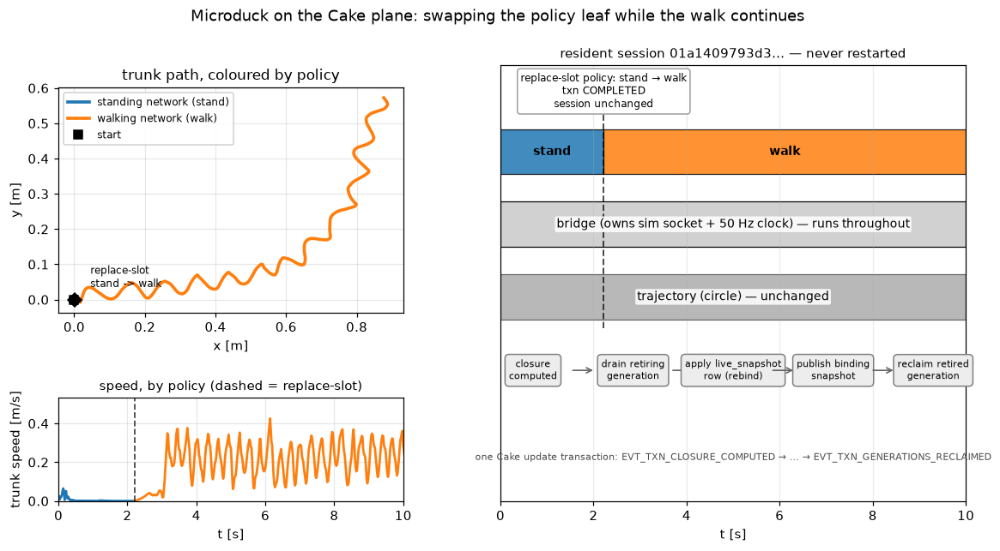

# Swapping the policy live

`make cake` swaps the **trajectory** under a live policy. This page is the other
half: swapping the **policy** under a live clock — the same `replace-slot`
transaction, applied to the module that computes the robot's action.

```sh
make fetch-cake
make policy-swap                    # stand -> walk: the duck stands, then walks
make policy-swap FROM=walk TO=stand # the other direction
make policy-swap PSECS=6            # shorter run
```

It runs `bin/run-policy-swap.sh`, which fetches the same precompiled release and
stages four Cake modules in one resident:

| module | owns | provides | requires |
| --- | --- | --- | --- |
| `bridge` | the sim socket + the 50 Hz tick | `observation` (61), `pose` (4) | `command` (13), `control` (14) |
| `policy` | — | `control` (14) | `observation` (61) |
| `trajectory` | a thread | `command` (13) | `pose` (4) |
| `spare_policy` | — | the swap target | `observation` (61) |

`policy` starts as the standing network, `spare_policy` holds the walking one.
`replace-slot` names the `policy` slot's uuid and points it at the walking
capsule; the resident never restarts.

## Why the policy is a leaf, and why that is the point

The policy cannot own the clock. If it did — the way the *fused* module in
`docs/cake-control-plane.md` does — then swapping it drains the thread that owns
the sim socket, the plant link goes away, and the walk stops. The transaction
still completes; the robot just stops walking.

So the split puts the socket and the clock in a stable `bridge` and makes the
policy a **leaf** the bridge consumes with a `live_snapshot` binding. During the
swap the bridge keeps ticking, re-reads the policy's action table from the
epoch-guarded binding snapshot, and cross-fades from the outgoing network's
action to the incoming one over 25 ticks — a bumpless hand-over, in the one
place that sees both generations.

The observable difference:

| | fused policy swap | split policy swap (`make policy-swap`) |
| --- | --- | --- |
| transaction | COMPLETED | COMPLETED |
| session identity | unchanged | unchanged |
| plant link | **torn down** — the sim client exits | **held** — the walk continues |
| result | duck stops at the swap | duck stands, then walks |

`make policy-swap` writes two figures under `MEDIA_DIR` (the committed copies
live in `docs/media/cake/`):

* `microduck_cake_policy_swap.gif` — the run itself, with the same tracking
  panel the trajectory GIF uses but driven by the *policy* schedule: the path is
  coloured by which policy drove it, and the bottom strip, "policy active over
  time (dashed = replace-slot swap)", names `stand` then `walk` across the swap.
  The duck balances in place under the standing policy for the first two
  seconds, then walks the circle; and
* `microduck_cake_policy_swap.png` — the run drawn the way the trajectory swap's
  figure is (`scripts/plot_cake_policy_swap.py`): the trunk path coloured by
  **which policy** drove it, the trunk speed beside it (near zero while it
  balances, ~0.2 m/s once it walks), and the running graph — the stable
  `bridge` across the whole axis, only the `policy` leaf's generation moving,
  the trajectory unchanged — over the update transaction that moved it.



_The same figure the trajectory swap draws, for the policy swap instead: the path
is coloured by which policy drove it (`stand` before the dashed marker, `walk`
after), the speed beside it is the gait change itself, and the right panel shows
the stable `bridge` running throughout while only the `policy` leaf's generation
moves. One run of `make policy-swap`._

## Reading the result

A run prints the transaction phase, the session identity before and after, and
the walk's own metrics:

```text
microduck-cake: transaction_phase COMPLETED
walk: steps=511 travel=1.155 m speed=0.113 m/s tilt=1.5 deg z=0.114 m
microduck-cake: policy swap (stand -> walk): PASS — transaction COMPLETED,
  session unchanged, the bridge held the plant link through the swap
```

`PASS` is the swap claim: the transaction completed, the session identity did
not change, and the bridge held the plant link for the whole window. Whether the
duck stayed *upright* is a control outcome and is reported in the metrics, not
asserted.

## The honest caveat

`FROM=stand TO=walk` works: the standing network holds the duck while the
walking network takes over, and the duck walks. The reverse —
`FROM=walk TO=stand` — completes the transaction and holds the link just as
well, but the duck **falls** (tilt ≈ 175°). The standing network is not a
mid-gait recovery controller, so a naive swap into it from a walk does not catch
the robot. That is a property of the networks, not of the swap: the transaction
is identical in both directions. A genuinely bumpless walk→stand would need the
incoming network to be a recovery policy (or a longer, state-aware blend).

## Requires a release with the split capsules

This demo needs a release whose `caps/` carries `microduck_bridge`,
`microduck_policy` and `microduck_policy_stand` alongside the fused
`microduck` and the trajectories. The bundle builder ships them
(`release/build-bundle.sh`); a release published before the split does not, and
`bin/run-policy-swap.sh` says so plainly rather than failing obscurely. To test
against a locally built bundle, point `MD_RELEASE_DIR` at its parent:

```sh
MD_RELEASE_DIR=/path/to/release/out make policy-swap
```
